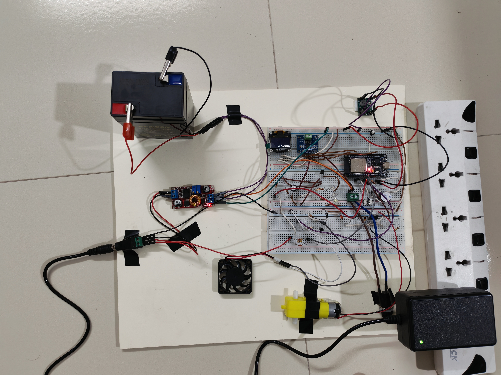
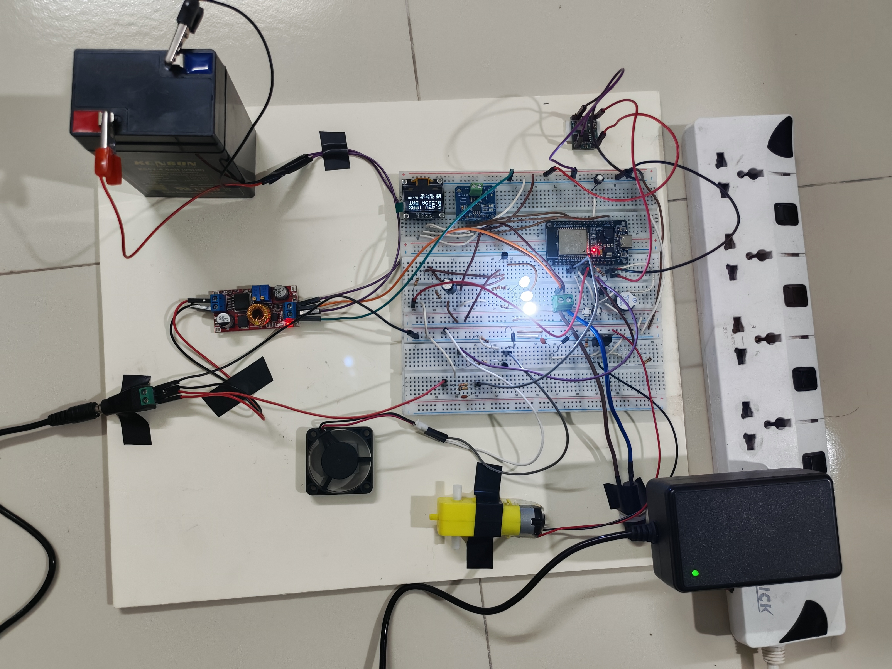

# IoT-Based Smart DC Microgrid

A bench-scale DC microgrid built around a 6 V, 4.5 Ah sealed lead-acid battery, an ESP32 controller and an INA219 current and voltage sensor. A charger keeps the battery topped up while the ESP32 switches three loads (an LED, a fan and a DC motor), protects the system, and reports every event to a phone through Telegram. The protection keeps working when WiFi is lost.

Capstone I project, Department of Electrical and Electronic Engineering, Rajshahi University of Engineering & Technology (RUET).



## Features

- **Priority load shedding:** as the battery voltage falls, the motor is cut first, then the fan, then the LED.
- **Automatic overload limit:** set at boot from the measured idle current, plus the three load currents, plus 0.12 A of headroom (about 0.61 A on battery).
- **Short-circuit fault:** a current above 1.2 A for 0.1 s switches everything off and latches.
- **Emergency stop,** START and STOP buttons, and a buzzer.
- **Telegram alerts** for every event (system online, overload, fault, emergency, low battery, restored, reset, grid lost, grid back), plus remote commands.
- **Protection never waits for the network:** the control loop runs on core 1 every 20 ms, and Telegram runs as a separate low-priority task on core 0.
- **Local OLED display** showing voltage, charge estimate, current, source (battery or charger), load states and WiFi status.

## Hardware

Power flows from the adapter through the charger to the battery, then through a 2 A fuse and the INA219 onto the load bus. The ESP32 reads the INA219, switches the three load channels and talks to the phone. Charging current is not measured, because the charger sits upstream of the sensor.

| Part | Role | Key value |
| --- | --- | --- |
| ESP32 DevKit V1 (WROOM-32) | Controller, WiFi, Telegram | 3.3 V logic, two cores |
| INA219 module | Current and bus voltage | 0.1 ohm shunt, I2C 0x40 |
| SSD1306 OLED, 0.96 in | Local display | 128 x 64, I2C 0x3C |
| 6 V 4.5 Ah sealed lead-acid battery | Energy storage | about 6.4 V full, at rest |
| XL4015 CC/CV module | Charger from the adapter | set to 6.9 V, 0.5 A limit |
| 12 V adapter | Grid source | feeds the charger and the grid-sense divider |
| MP1584 buck module | 5 V rail for the ESP32 and buzzer | set to 4.96 V |
| IRLZ44N MOSFET | Motor switch | 100 ohm gate resistor, 10 kohm pulldown |
| 2N2222 transistors | LED, fan and buzzer switches | 10 kohm pulldown |
| 1N5819 Schottky diode | Motor flyback protection | cathode on the load bus |
| Loads | 3 white LEDs, DC fan, TT gear motor | 0.068 A, 0.14 A, 0.20 A |
| 2 A fuse | Series protection | between the battery node and the INA219 |

Pin map (D numbers are the labels printed on the board):

| Pin | Function |
| --- | --- |
| D21 / D22 | I2C SDA / SCL (INA219 and OLED) |
| D25 | LED channel |
| D26 | Fan channel |
| D27 | Motor channel |
| D14 | Buzzer |
| D32 / D33 / D4 | START / STOP / EMERGENCY buttons |
| D34 | Grid sense (ADC input, resistor divider) |

## Firmware logic

Four rules run in a fixed priority: Emergency, then Fault, then Overload, then Low battery. At boot all three loads are requested and start one by one, 1.5 s apart (LED, Fan, Motor).

| Rule | Trigger | Action | Return |
| --- | --- | --- | --- |
| Emergency | EMERGENCY button | All loads off, buzzer, latched | Release the button, then /reset or START |
| Fault | Current above 1.2 A for 0.1 s | All loads off, buzzer, latched | /reset or START |
| Overload | Average current above the limit for 0.4 s | Cut the lowest priority load that is on (Motor, then Fan, then LED) | After at least 20 s, if there is room |
| Low battery | Below 6.15 V (Motor), 6.05 V (Fan), 5.85 V (LED) | Cut that load | Above 6.23 V, 6.13 V, 5.95 V, one load every 1.5 s |

Measurement details that keep the rules reliable:

- Current is averaged over about 0.1 s and voltage over about 5 s. The voltage lost in the wires and fuse is added back (path resistance 1.2 ohm), so a load turning on does not look like a flat battery.
- Current is ignored for 0.4 s after a load turns on, to skip the motor start-up surge.
- When WiFi is down, the overload limit is raised by 0.05 A because the radio then scans continuously.
- The INA219 is re-initialised if it reads exactly 0 A and 0 V, and its calibration is refreshed every 2 s.
- Grid presence comes from the D34 divider with a 1.5 s debounce. While the charger is present, battery-based cutting is disabled, but overload and fault protection stay on.

## Telegram commands

Accepted from the owner's chat only.

| Command | Effect |
| --- | --- |
| /status | State, grid, battery voltage and percent, current, limit, which loads are on |
| /start | Request all loads and clear a latch |
| /stop | All loads off |
| /reset | Clear a fault or emergency latch |
| /sim 6.00, /sim off | Pretend the battery is at that voltage (test mode), or return to the real reading |
| /trip 0.30, /trip off | Temporarily lower the fault threshold, for demonstration |
| /limit 0.40, /limit off | Temporarily lower the overload limit, for demonstration |

## Test results

Nine functional tests passed on 28 October 2026, with the system running from the battery only, a 2.4 GHz phone hotspot for WiFi, and the adapter unplugged unless stated:

1. Power-up on battery
2. Boot sequence
3. Overload
4. Short-circuit fault
5. Low battery (simulated voltage)
6. Recovery
7. Emergency stop
8. No WiFi
9. Grid detection

Test 8 failed on its first run: the overload check was skipped whenever the network task was busy, and with no WiFi it was always busy. The check was fixed and the test repeated.

Four of the tests (4, 7, 8 and 9) ran on an earlier version of the load policy. The protection logic is the same, and they are on the re-test list for the final firmware. The full report is in the `docs` folder.

## Photos



## Limitations

- The battery state is estimated from voltage only. A full real discharge run has not been done yet, and the low-battery sequence was verified with a simulated voltage.
- Charging current is not measured.
- The overload limit follows the measured load currents. Replacing a load means measuring it again.
- A stalled motor may exceed 1.2 A and trigger the fault instead of the overload.
- The wiring is on breadboards (about 1.2 ohm path resistance). Soldered or crimped joints would reduce it.
- There is a single 2 A fuse, on the battery side only.
- Alerts need a 2.4 GHz WiFi network and internet. The protection does not.

This is a bench prototype at 6 V and about 0.5 A. It is not a certified product.

## Future work

- A logged full discharge test
- Current sensing on the charger side
- A printed circuit board in place of the breadboards
- A web dashboard in addition to Telegram

## Repository contents

```
smart-dc-microgrid/
  firmware/   ESP32 sketch (Arduino IDE)
  docs/       project report (PDF)
  images/     photos of the prototype
  README.md
```

## Build and run

1. Open the sketch in the `firmware` folder with the Arduino IDE and select the ESP32 DevKit V1 board.
2. Install the libraries listed in the `#include` lines at the top of the sketch.
3. Add your own WiFi name and password, Telegram bot token and owner chat ID. These are deliberately not stored in this repository.
4. Upload the sketch and open the Serial Monitor.

## Safety

The board carries 6 V DC only. Mains voltage stays inside the adapter. The battery is connected last, through the fuse.

## Author

Md. Raiyan Mahmud, EEE, RUET. Portfolio: https://raiyan2064.github.io
